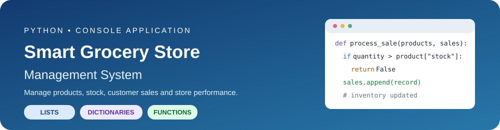
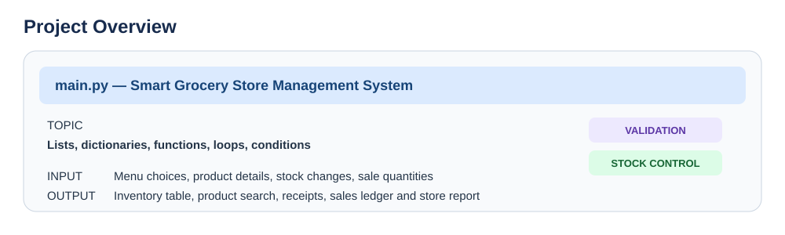
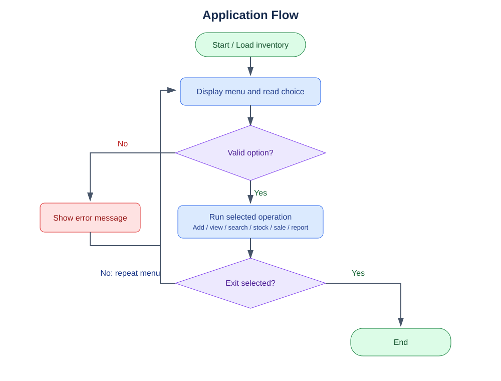
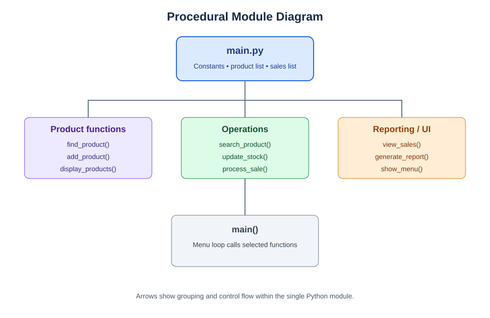

<p align="center"></p>

# Smart Grocery Store Management System

## 1. Project Overview

A menu-driven Python application for maintaining grocery products, stock levels and customer sales. Product and sales records are stored as lists of dictionaries while the program is running.

| Task | File | Topics |
|---|---|---|
| Smart Grocery Store Management System | `main.py` | Lists, dictionaries, functions, loops, conditions, validation and calculations |
| Automated tests | `tests/test_main.py` | Unit testing, mocked input and output assertions |



## 2. Folder Structure

```text
smart-grocery-store-management-system/
├── assets/
│   ├── banner.svg
│   ├── banner.png
│   ├── overview.svg
│   ├── overview.png
│   ├── main_flow.svg
│   ├── main_flow.png
│   ├── uml_diagram.svg
│   └── uml_diagram.png
├── tests/
│   └── test_main.py
├── .gitignore
├── README.md
└── main.py
```

PNG versions are included beside the requested SVG assets so the diagrams can also be previewed outside Markdown/SVG-supporting viewers.

## 3. Smart Grocery Store Management System

### Summary

`main.py` provides an interactive menu for product management, product search, stock adjustments, customer sales, sales history and a store report. It starts with three example products (Milk, Bread and Rice); new sales are recorded in a separate in-memory list.

### Rules and requirements

- Each product is a dictionary with `id`, `name`, `category`, `price` and `stock` keys.
- New product dictionaries are added with `products.append()`; duplicate IDs are rejected.
- Products can be searched by ID or a case-insensitive name fragment.
- Stock can be increased or replaced, including setting it to zero.
- A sale is accepted only when the product exists and the requested positive quantity is in stock.
- A successful sale deducts stock and appends a sales dictionary containing product ID, product name, quantity sold and total amount.
- The report calculates inventory totals, transaction count, revenue, low-stock products and price extremes.
- The menu repeats until option 8 is selected.

### Program Flow



### Code Methods Description

| Method or section | Purpose |
|---|---|
| `find_product()` | Finds a product dictionary by ID. |
| `read_integer()` | Validates integer input and enforces a minimum value. |
| `read_price()` | Accepts only numeric prices greater than zero. |
| `add_product()` | Collects product data, rejects duplicate IDs and appends a dictionary. |
| `display_products()` | Prints the current inventory in a readable table. |
| `search_product()` | Searches by ID or product name and prints complete details. |
| `update_stock()` | Adds stock or sets a new stock quantity. |
| `process_sale()` | Validates a sale, calculates its total, updates stock and records the transaction. |
| `view_sales()` | Displays completed sales records. |
| `generate_report()` | Calculates and displays the store summary. |
| `show_menu()` | Prints the eight menu options. |
| `main()` | Initializes the lists and dispatches menu choices in a loop. |

### Input Validation

- Menu choices must be from 1 to 8.
- IDs and quantities must be whole numbers; IDs and purchase quantities must be at least 1.
- Stock quantities may be zero but cannot be negative.
- Prices must be numeric and greater than zero.
- Product names and categories cannot be blank.
- Duplicate product IDs, unknown product IDs, invalid stock actions and purchases exceeding stock are rejected with messages.

### Expected Results

The application displays updated inventory and stock, confirms successful purchases with their total and remaining stock, rejects invalid transactions without changing inventory, and generates an accurate report. The initial sample inventory has 3 products and 36 total units. Data is held in memory and resets to the sample inventory when the program is restarted.

## 4. UML Diagram

A **procedural module diagram** is used because the solution is a single procedural Python module with reusable functions rather than classes.



## 5. Concepts and Techniques Used

- Lists of dictionaries for product and sales records.
- Dictionary keys and values for reading and updating records.
- Custom functions with parameters and return values.
- `for` and `while` loops for searching, displaying and menu repetition.
- `if` / `elif` / `else` conditional logic.
- Input validation with `try` / `except`.
- `append()`, `sum()`, `max()` and `min()` for data handling and reporting.
- Unit tests with `unittest` and mocked interactive input.

## 6. How to Run

### Requirements

- Python 3.8 or newer.
- No third-party packages are required to run the application.

### Clone the repository

Replace `[YOUR USERNAME]` with your GitHub username after creating the repository with this folder's name.

```bash
git clone https://github.com/[YOUR USERNAME]/smart-grocery-store-management-system.git
cd smart-grocery-store-management-system
```

### Run the application

```bash
python main.py
```

Alternative commands:

```bash
python3 main.py       # Linux / macOS
py main.py            # Windows Python launcher
```

### Run automated tests

```bash
python -m unittest discover -s tests -v
```

## 7. Sample Execution

The following excerpts are from an actual run of `python main.py`, using the seeded inventory and the inputs shown. Milk is purchased successfully, an over-stock Rice purchase is rejected, Milk is searched, and the report is generated.

**Successful sale (inputs: menu `5`, product ID `101`, quantity `2`):**

```text
Purchase successful
Product: Milk
Quantity: 2
Total: Rs. 500.00
Remaining stock: 18
```

**Rejected sale (inputs: menu `5`, product ID `103`, quantity `5`):**

```text
Sale rejected: only 4 unit(s) available.
```

**Search result (inputs: menu `3`, search `Milk`):**

```text
ID: 101 | Name: Milk | Category: Dairy | Price: Rs. 250.00 | Stock: 18
```

**Store report (after the sale):**

```text
========== STORE REPORT ==========
Total products: 3
Total available stock: 34
Total sales transactions: 1
Total revenue: Rs. 500.00
Products below 5 units: Rice
Highest-priced product: Milk (Rs. 250.00)
Lowest-priced product: Bread (Rs. 120.00)
==================================
```

## 8. Test Cases

All cases below were executed successfully by the included `unittest` suite (16 tests passed).

| # | Scenario | Inputs | Expected result |
|---:|---|---|---|
| 1 | Add a valid product with zero stock | `3, Eggs, Dairy, 90, 0` | Product appended successfully. |
| 2 | Duplicate product ID | `1` (existing ID) | Rejected; product count unchanged. |
| 3 | Search by mixed-case name | `mIlK` | Milk details returned. |
| 4 | Search for missing product | `Juice` | “Product not found.” |
| 5 | Increase stock | `ID 1, action 1, quantity 3` | Stock increases from 5 to 8. |
| 6 | Set stock to zero | `ID 1, action 2, quantity 0` | Stock becomes 0. |
| 7 | Update unknown product | `ID 99` | Rejected with not-found message. |
| 8 | Invalid stock action | `ID 1, action 9` | Rejected with invalid-option message. |
| 9 | Successful sale at exact available stock | `ID 1, quantity 5` | Sale recorded; stock becomes 0; total is Rs. 1,250.00. |
| 10 | Sale exceeds stock | `ID 1, quantity 6` | Sale rejected; stock and sales list unchanged. |
| 11 | Sale for missing product | `ID 99` | Sale rejected. |
| 12 | Invalid integer and below-minimum integer | `abc, 0, 4` | Invalid values rejected; 4 accepted. |
| 13 | Invalid and non-positive prices | `bad, 0, 12.5` | Invalid values rejected; 12.5 accepted. |
| 14 | Blank name/category and negative stock | blank, `Eggs`, blank, `Dairy`, `80`, `-1`, `0` | Blank text and negative stock rejected; valid product appended. |
| 15 | Sale from zero-stock product | `ID 2, quantity 1` | Sale rejected; no transaction recorded. |
| 16 | Empty and normal report | empty lists; then seeded products | N/A price extremes for empty inventory; correct low-stock and price extremes otherwise. |
| 17 | Empty inventory and sales display | empty lists | Appropriate empty-state messages displayed. |

---

**Author:** [Hira Aslam]  
**GitHub:** [its-hiraaslam](https://github.com/[its-hiraaslam])
